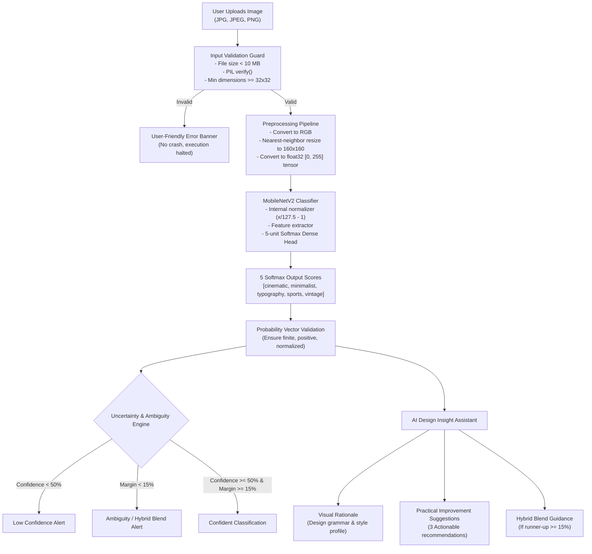

# AI Graphic Design Classifier — Final Application

An end-to-end computer vision web application integrating a deep learning transfer learning model with an **AI Design Insight Assistant** to classify graphic design styles, detect multi-style ambiguities, and offer transparent, rule-based composition recommendations.

**Internship:** SWYNEX Technologies  
**Task Track:** Task 4 — Final AI Application  
**Repository Name:** `SWYNEX-Final-AI-Application`  
**Base Architecture:** MobileNetV2 (ImageNet Pre-trained) + GlobalAveragePooling2D + Dropout + Softmax Dense Head  
**Environment:** Python 3.12 (Windows 10/11 Compatible)

---

## 1. Project Title and Overview

The **AI Graphic Design Classifier — Final Application** is an interactive, browser-based artificial intelligence prototype built using Streamlit and TensorFlow/Keras. It bridges the gap between raw machine learning classification outputs and practical graphic design workflow by:
1. Classifying posters, artwork, and banners into five fundamental design styles: **Cinematic**, **Minimalist**, **Typography**, **Sports**, and **Vintage**.
2. Analyzing the model's output distribution to detect low-confidence predictions and ambiguous runner-up styles.
3. Generating rule-based **AI Design Insights** (composition rationale, visual grammar explanations, and 3 actionable improvement suggestions).
4. Providing full transparency on model evaluation, training constraints, and responsible AI ethics.

---

## 2. Problem Statement

Graphic design styles convey distinct emotional and aesthetic messages:
* *Cinematic* designs communicate narrative scale and theatrical mood.
* *Minimalist* designs command focus through disciplined negative space.
* *Typography* designs transform expressive letterforms into the primary artwork.
* *Sports* designs radiate kinetic power, diagonal motion, and athletic energy.
* *Vintage* designs evoke nostalgic heritage through analog warmth and distressed textures.

However, modern creative assets often blend multiple aesthetic movements. Standard computer vision models output a single numerical score without creative explanation, leaving designers unsure whether a low score reflects a poor design or an intentional hybrid fusion. Furthermore, machine learning prototypes often suffer from brittleness when handling invalid files, missing assets, or corrupted inputs. This application solves both challenges by combining resilient edge-case validation with deterministic design heuristic explanations.

---

## 3. Objectives

* **Model Integration:** Integrate the trained Keras 3 `MobileNetV2` classifier into an interactive, high-performance web interface.
* **Intelligent Feature:** Implement the **AI Design Insight Assistant** to provide deterministic composition analysis and creative refinement tips without external API dependencies.
* **Dual-Condition Uncertainty Detection:** Detect when top model confidence is low ($< 50\%$) or when top predictions are closely contested (margin $< 15\%$), flagging hybrid styles for human review.
* **Resilient Error Handling:** Prevent crashes by validating file size ($< 10\text{ MB}$), minimum dimensions ($\ge 32 \times 32\text{ px}$), non-image files, and non-finite tensors (`NaN`/`Inf`).
* **Transparent Evaluation & Ethics:** Report genuine model evaluation metrics honestly without exaggerating small-dataset performance or fabricating accuracy claims.

---

## 4. Methodology & AI Workflow

The application executes a multi-stage pipeline:



### Key Technical Pipeline Facts:
* **Input Tensor:** `(1, 160, 160, 3)` float32 array.
* **Embedded Scaling:** The Keras model contains an internal MobileNetV2 preprocessing layer (`x / 127.5 - 1`). The input array remains in the raw `[0, 255]` range; **no redundant `/255` division is applied**.
* **Fixed Class Ordering:** Mapped directly to the Task 1 training list: `["cinematic", "minimalist", "typography", "sports", "vintage"]`.

---

## 5. Technologies Used

* **Programming Language:** Python 3.12 (Selected for optimal TensorFlow and Windows compatibility).
* **Deep Learning Framework:** TensorFlow 2.21 / Keras 3.15 (Local CPU inference).
* **Web UI Framework:** Streamlit 1.66.
* **Image Processing:** Pillow (PIL) 13.0.
* **Numerical Processing:** NumPy 2.5.
* **Automated Testing:** Pytest 9.1.
* **Version Control:** Git & GitHub.

---

## 6. Features

1. **Interactive Classification Workspace:** Upload user artwork or test using the five verified dataset samples.
2. **Explicit Classification Trigger:** Includes a dedicated `"🔍 Classify Graphic Design Style"` button with session state memory.
3. **Dual Preview & Output Cards:** View the input image side-by-side with the classification metric and 5-class progress bars.
4. **AI Design Insight Assistant:**
   - **Visual Rationale:** Explains why lighting, contrast, typography, and negative space triggered the style match.
   - **3 Actionable Suggestions:** Specific creative tips on color harmony, focal depth, grid systems, and typography.
   - **Hybrid Style Blend Note:** Highlights when an artwork fuses two styles (e.g. Minimalist + Typography).
5. **Dual-Condition Uncertainty Alerts:** Transparently surfaces warnings when confidence is low or when runner-up styles are within 15%.
6. **Robust Error Guards:** Friendly error banners for oversized files, corrupted binaries, tiny images, and non-finite outputs.
7. **Comprehensive Tabbed Interface:**
   - *Tab 1:* Classifier & AI Assistant
   - *Tab 2:* About the Model & Architecture
   - *Tab 3:* Evaluation & Dataset Limitations
   - *Tab 4:* Privacy, Security & Responsible AI

---

## 7. Project Structure

```text
SWYNEX-Final-AI-Application/
├── .gitignore                          # Excludes venv, pycache, test caches, secrets
├── app.py                              # Main Streamlit web application
├── insights.py                         # AI Design Insight Assistant heuristics engine
├── README.md                           # Comprehensive documentation & submission guide
├── requirements.txt                    # Project dependencies (Streamlit, TensorFlow, Pytest, etc.)
│
├── model/
│   └── graphic_design_classifier.keras # Trained Keras 3 model artifact (~9.7 MB)
│
├── evaluation/
│   ├── evaluate_model.py               # Automated evaluation and edge-case test script
│   ├── evaluation_report.md            # Live generated evaluation report with real test results
│   └── evaluation_examples.md          # Comprehensive evaluation documentation and test plan
│
├── tests/
│   ├── test_insights.py                # Automated tests for insight heuristics & uncertainty
│   ├── test_preprocessing.py           # Automated tests for image tensor preprocessing
│   └── test_error_handling.py          # Automated tests for invalid/corrupted files
│
├── examples/
│   ├── cinematic_01.jpg                # Valid sample: Cinematic (87.5%)
│   ├── minimalist_02.jpg               # Valid sample: Minimalist (31.9%, Ambiguous case)
│   ├── sports_01.jpg                   # Valid sample: Sports (91.3%)
│   ├── typography_01.jpg               # Valid sample: Typography (95.7%)
│   ├── vintage_01.jpg                  # Valid sample: Vintage (97.8%)
│   └── example_outputs.md              # Documented sample test results
│
└── screenshots/
    └── README.md                       # Instructions for capturing submission screenshots
```

---

## 8. Installation Instructions (Windows & VS Code)

### Prerequisites
* Windows 10/11, macOS, or Linux.
* **Python 3.12** installed (TensorFlow requires Python $\le 3.12$; Python 3.15 is not supported on Windows).

### Step-by-Step Setup

```powershell
# 1. Open PowerShell and navigate to the project root
cd D:\SWYNEX-Model-or-API-Integration

# 2. Check that Python 3.12 is available
py -3.12 --version

# 3. Create a clean virtual environment using Python 3.12
py -3.12 -m venv venv

# 4. Activate the virtual environment
.\venv\Scripts\Activate.ps1

# 5. Upgrade pip to the latest release
python -m pip install --upgrade pip

# 6. Install all project dependencies
pip install -r requirements.txt

# 7. Run the automated unit tests (21 tests)
pytest tests

# 8. Run the model evaluation suite
python evaluation/evaluate_model.py

# 9. Launch the Streamlit application
streamlit run app.py
```

Your browser will automatically open at: **`http://localhost:8501`**.

> [!NOTE]
> If PowerShell displays an execution policy error on script activation, run:
> ```powershell
> Set-ExecutionPolicy -Scope CurrentUser -ExecutionPolicy RemoteSigned
> ```

---

## 9. How to Use the Application

1. **Launch the application** following the installation steps above.
2. Select your input method in **Tab 1**:
   - **Upload your own image:** Drag and drop any JPG, JPEG, or PNG poster (under 10 MB).
   - **Try an example from the dataset:** Pick one of the 5 verified sample images.
3. Review the high-resolution image preview and original pixel dimensions.
4. Click **`🔍 Classify Graphic Design Style`**.
5. Observe the results:
   - **Predicted Style & Confidence:** Check the dominant category and score percentage.
   - **Uncertainty Box:** If the design is ambiguous or low-confidence, note the explanation and recommendation.
   - **Probability Breakdown:** Review the progress bars across all five styles.
   - **AI Design Insights:** Read the **Visual Rationale** and implement the **3 Actionable Suggestions**.
6. Switch to **Tabs 2, 3, and 4** to explore architecture details, evaluation metrics, and responsible AI guidelines.

---

## 10. Example Inputs and Actual Outputs

The following live results were generated by [`evaluation/evaluate_model.py`](evaluation/evaluate_model.py):

| Sample Image | Predicted Style | Top Score | Runner-Up Style | Margin | Status & Behavior |
|---|---|---|---|---|---|
| `vintage_01.jpg` | **Vintage** | 97.8% | Sports (0.8%) | 97.0% | ✅ Confident. Clear top prediction. |
| `typography_01.jpg` | **Typography** | 95.7% | Sports (1.8%) | 93.9% | ✅ Confident. High text-feature recognition. |
| `sports_01.jpg` | **Sports** | 91.3% | Cinematic (5.1%) | 86.2% | ✅ Confident. Dynamic diagonal emphasis. |
| `cinematic_01.jpg` | **Cinematic** | 87.5% | Sports (6.8%) | 80.6% | ✅ Confident. Strong atmospheric shadows. |
| `minimalist_02.jpg` | **Minimalist** | 31.9% | Typography (22.0%) | 9.9% | ⚠️ **Uncertain:** Triggered both Low-Confidence (<50%) and Ambiguity Margin (<15%) warnings; generated Hybrid Blend Note. |

---

## 11. Model Evaluation & Automated Testing

### Automated Test Suite (`pytest tests`)
The test suite consists of **21 automated unit tests** covering three test modules:
* [`tests/test_insights.py`](tests/test_insights.py): Validates probability vector bounds, non-finite rejection (`NaN`/`Inf`), style profile mappings, low-confidence thresholding, and ambiguity margin heuristics.
* [`tests/test_preprocessing.py`](tests/test_preprocessing.py): Validates output tensor shape `(1, 160, 160, 3)`, float32 data type, raw `0–255` range preservation, and RGBA/grayscale color conversion.
* [`tests/test_error_handling.py`](tests/test_error_handling.py): Validates handling of null inputs, oversized files ($>10\text{ MB}$), corrupted non-image binaries, tiny images ($<32\times 32\text{ px}$), missing model path simulations, and unexpected output tensor dimensions.

**Execution Result:**
```text
============================= test session starts =============================
platform win32 -- Python 3.12.10, pytest-9.1.1, pluggy-1.7.0
rootdir: D:\SWYNEX-Model-or-API-Integration
collected 21 items

tests/test_error_handling.py .........                                   [ 42%]
tests/test_insights.py .........                                         [ 85%]
tests/test_preprocessing.py ...                                          [100%]

============================= 21 passed in 5.97s ==============================
```

---

## 12. Limitations

1. **Small Sample Training Dataset:** The model was trained in Task 1 on **20 AI-generated images (4 per style)**. This dataset size is educational and insufficient for production commercial deployment.
2. **No Independent Generalization Guarantee:** While the model executes consistently on existing samples, no general commercial accuracy is claimed for unseen human artwork.
3. **Uncalibrated Softmax Distribution:** Softmax probabilities sum to 1.0 across closed options, which can produce high scores even when an image does not belong to any design category.
4. **Closed Classification Space:** The model forces every input into one of five categories and cannot natively identify out-of-distribution subjects (e.g. natural landscapes, portraits, or documents).

---

## 13. Ethical Considerations and Responsible AI

* **Uncalibrated Scores:** Model confidence scores reflect mathematical optimization, not real-world certainty.
* **Non-Authoritative Judgments:** The application is an educational prototype and creative inspiration tool; its outputs must not be treated as professional or legal design verdicts.
* **Intellectual Property Respect:** The classifier evaluates visual aesthetics only and makes no claims regarding copyright ownership, artist attribution, or design originality.
* **Dataset Bias:** Due to the small AI-generated training set, the model may exhibit bias toward specific lighting, rendering textures, or high-contrast color palettes.
* **Human-in-the-Loop:** Creative direction should always remain with the human designer. Manual review is strongly advised when uncertainty flags appear.

---

## 14. Privacy and Security

* **100% Local Execution:** All image processing and model inference run on your local computer's CPU.
* **Zero Network Calls:** No uploaded images, filenames, or user data are sent over the Internet.
* **No Image Retention:** Uploaded files exist strictly in temporary memory during your interactive session and are discarded upon closing the tab.
* **Zero Stored Credentials:** The application contains no API keys, secrets, database connections, or authentication tokens.

---

## 15. Future Improvements

1. **Curated Benchmark Dataset:** Assemble 500+ diverse, human-designed posters and apply a stratified 70/15/15 train/validation/test split.
2. **Multi-Label Classification:** Transition from single-label softmax to multi-label sigmoid outputs to formally model hybrid styles.
3. **Probability Calibration:** Apply temperature scaling or Platt scaling to align confidence scores with real-world empirical accuracy.
4. **Out-of-Distribution (OOD) Detection:** Implement entropy thresholds or reconstruction autoencoders to reject non-poster inputs gracefully.
5. **Data Augmentation & Fine-Tuning:** Unfreeze the top layers of MobileNetV2 with cosine decay learning rates and rotation/shear augmentation.

---

## 16. Conclusion

Through the four tasks of the SWYNEX Technologies internship, this project evolved from a basic transfer-learning model into a full-featured, resilient AI application. The final system demonstrates:
* Clean model deployment with cached resource loading.
* Defensive programming with input validation guards.
* An intelligent feature that adds value through transparent, rule-based design insights.
* An honest, scientifically grounded approach to machine learning evaluation and ethics.

---

## 17. Internship Information

* **Organization:** SWYNEX Technologies
* **Internship Track:** AI / Machine Learning Internship
* **Task Completed:** Task 4 — Final AI Application
* **Developer:** Maniram
* **GitHub Repository:** `SWYNEX-Final-AI-Application`
